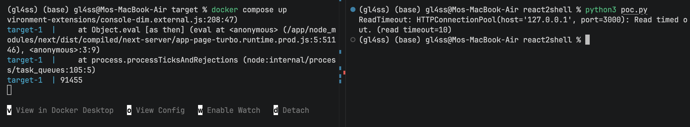

# React2Shell (CVE-2025-55182) 로컬 재현



위 화면은 `poc.py`를 보냈을 때의 기록이다. 왼쪽 서버 로그에 `91455`가 출력됐고, 오른쪽 클라이언트는 응답을 기다리다 타임아웃됐다. 실행 여부는 HTTP 응답만으로 판단하지 않는다.

`server/`는 Next.js 16.0.6과 React 19.2.0으로 만든 취약 서버다. 기본 페이지는 `Hello, this is gl4ss!`를 출력한다. Docker Compose는 호스트의 `127.0.0.1:3000`에만 포트를 연결한다.

## 실행

아래 명령은 저장소 루트에서 실행한다. 먼저 서버를 시작한다.

```sh
cd server
docker compose up --build -d
curl -i http://127.0.0.1:3000/
docker compose logs -f target
```

다른 터미널에서 Python PoC를 보낸다.

```sh
python3 -m pip install -r requirements.txt
python3 poc.py
```

`poc.py`는 출력 표지로 `91455`를 쓴다. 서버 로그의 `91455`와 `[lab] PoC marker stack`을 확인한다. 종료할 때는 `server/`에서 `docker compose down`을 실행한다.

## 파일

- [`poc.py`](poc.py): `requests`로 보내는 Python PoC.
- [`server/`](server/): 취약 서버와 Docker Compose 설정.

